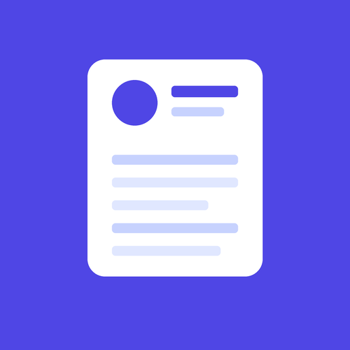

# CV Builder

A free CV and resume maker that works offline. Nothing you type leaves your device.

**Use it here:** https://ashir-mansuri.github.io/cv-builder/

## Write
- Write your details once and the CV builds itself, with a live preview
- **6 regional styles:** India, Europe, UK, USA, Canada and Gulf. Each one shows only what is normal there (photo, date of birth, visa status, declaration, A4 or Letter paper)
- Sections for experience, education, skills, projects, achievements and awards, positions of responsibility, volunteering, certifications, languages, publications, interests and references, plus **your own sections**
- 8 sample CVs: fresher, MBA, experienced professional, engineer (Gulf), nurse (UK), accountant, sales (USA) and academic
- Phrase bank with ready-made bullet points for 10 fields
- **Weak-phrase finder:** flags phrases like "responsible for" and suggests stronger ones
- Photo with zoom and crop, plus a signature you can draw or upload
- Undo, and automatic restore points
- **One-tap bullet improver** and **proofreading** (dates, gaps, tense, spelling, consistency)
- **Import an existing CV** from a Word file or pasted text
- **Home page** with all your CVs

## ATS check (job portals)
- ATS score in 4 parts: format & layout, readability, keyword match and content
- Settings: Lenient / Standard / Strict checking, target job title, your own must-have key words, words to ignore, UK/US spelling and abbreviation matching
- Paste a job advert: must-have vs nice-to-have key words (and where they appear in your CV), plus job title, years of experience and degree checks
- "How an ATS reads your CV": contact details, work history with months, education, skills and section headings, plus the plain text
- One-tap fixes, an ATS-safe copy, and **Tailor to this job** (a tailored copy that only reorders and highlights what is already true)

## Design
- 4 templates, 12 colours plus any custom colour, 4 fonts, 3 text sizes, and a black & white print mode

## Download
- CV score with tips, page counter, and a job advert checker that finds missing key words
- **PDF and Word (.docx)** for both the CV and the cover letter
- Plain-text copy for job portals, backup files, and one-tap sharing to WhatsApp or email on phones

## Jobs
- **Application tracker:** company, date, CV used, status and follow-up reminders
- **Calendar reminders** for interviews and follow-ups (calendar file or Google Calendar)
- **Insights:** reply rate, interview rate, average days to hear back, applications per week, results by CV version
- **LinkedIn helper:** headline, About, experience and skills, ready to paste
- **Interview prep:** common questions plus field-specific ones, with the STAR method

## Privacy
There's no sign-up, no server and no tracking. Everything is saved only in your own browser. Use **Save backup file** to keep a copy.
